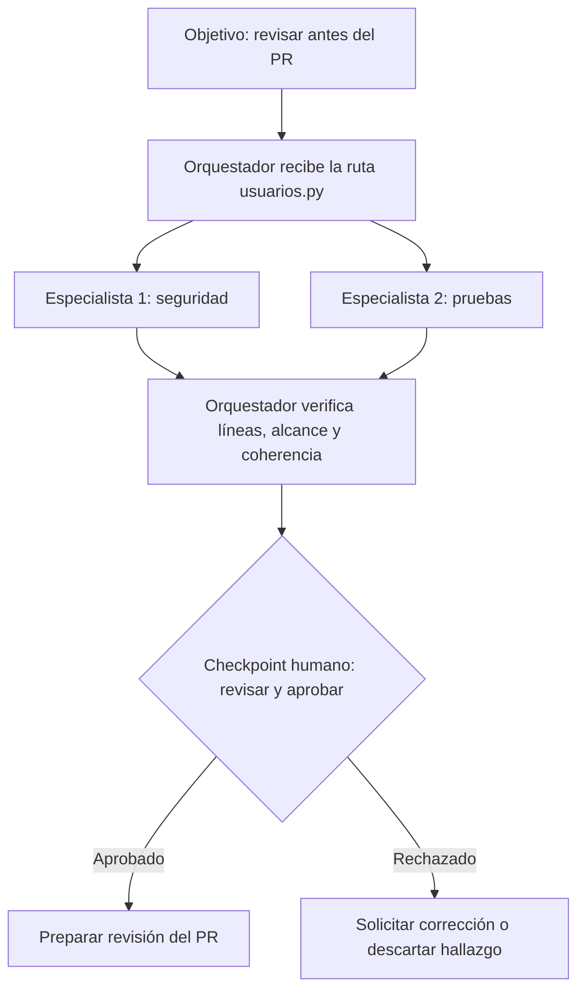
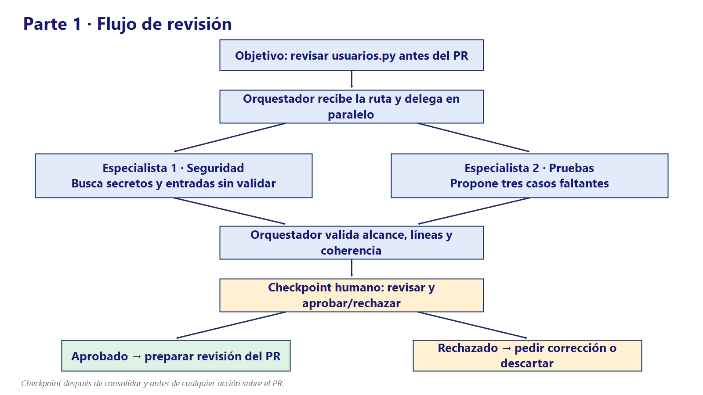
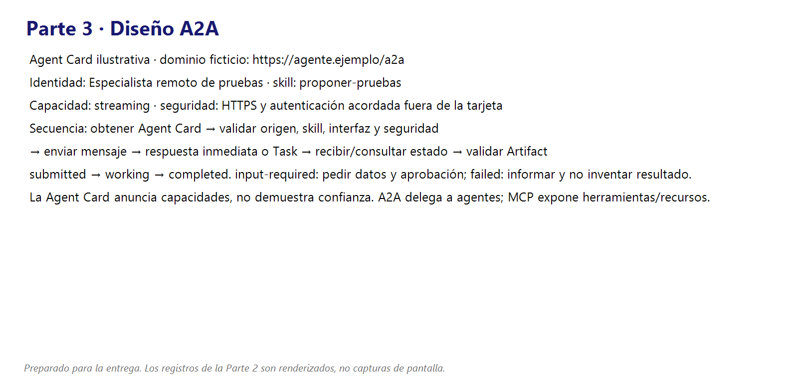

# Equipo de agentes — revisión previa al pull request

Archivo objetivo: `usuarios.py` (ruta desde la raíz del repositorio).

| Agente | Misión | Herramientas autorizadas | Entrada | Salida | Límites |
|---|---|---|---|---|---|
| Orquestador | Repartir la revisión y consolidar resultados | Ninguna propia; solo delega | `usuarios.py` | Tabla con hallazgos de seguridad y casos de prueba | No modifica archivos ni ejecuta cambios sin aprobación humana |
| Especialista 1 — Seguridad | Buscar secretos hardcodeados y entradas sin validar | Buscar y leer archivos | Ruta de `usuarios.py` | Lista: línea, problema, severidad | Solo ese archivo; solo lectura; no escribe |
| Especialista 2 — Pruebas | Proponer 3 pruebas faltantes | Leer archivos | Ruta de `usuarios.py` | Lista: nombre del caso y qué verifica | Solo propone; no crea ni ejecuta pruebas |

## Flujo y checkpoint humano





Los especialistas trabajan en paralelo porque sus tareas no dependen entre sí.
El checkpoint humano ocurre después de consolidar y validar las dos salidas y
antes de preparar cualquier comentario o cambio para el pull request.

La persona comprueba que cada hallazgo exista en la línea citada, que la
severidad sea proporcional y que cada propuesta de prueba sea verificable,
pertinente y realmente falte. Rechaza una cita inexistente, una conclusión que
no se desprenda del código, una prueba redundante o una salida que exceda el
alcance de `usuarios.py`.

El orquestador detecta fallas si una salida está vacía sin explicación, cita
líneas inexistentes, no responde al formato pedido, analiza otros archivos o
propone modificar el código. Pide una corrección acotada al especialista y
revalida la respuesta. Si el error persiste, marca el resultado como no
verificado y avisa a la persona; no inventa ni completa hallazgos por su cuenta.

### Casos que propondría el Especialista 2

1. **`buscar_usuario` con comillas en el nombre:** verifica que la entrada se
   trate como dato y no altere la consulta SQL. El caso expone el riesgo actual
   de concatenación.
2. **`crear_usuario` con edad negativa y correo mal formado:** verifica la
   validación de dominio antes de guardar. La consulta usa parámetros SQL, pero
   el archivo no valida esos valores.
3. **`calcular_descuento` con porcentajes 0, 100 y fuera de rango:** verifica
   límites y resultados de borde, y que porcentajes negativos o mayores a 100
   se rechacen según la política del producto.

## A2A

*Simplificación didáctica; no es JSON conforme a una versión específica de A2A.*

```json
{
  "identity": {
    "name": "Especialista remoto de pruebas",
    "provider": "Equipo de calidad de ejemplo"
  },
  "description": "Propone casos de prueba faltantes para un archivo fuente indicado.",
  "skills": [
    {
      "id": "proponer-pruebas",
      "description": "Devuelve tres casos de prueba con nombre y comportamiento esperado."
    }
  ],
  "interface": {
    "protocol": "A2A",
    "endpoint": "https://agente.ejemplo/a2a"
  },
  "capabilities": {
    "streaming": true
  },
  "security": {
    "authentication": "Requiere autenticación acordada fuera de esta tarjeta.",
    "transport": "HTTPS",
    "dataPolicy": "Enviar solo el archivo necesario; no enviar secretos."
  }
}
```

El orquestador obtiene la tarjeta desde una URL configurada por el equipo,
`/.well-known/agent-card.json` o un registro confiable. Antes de enviar nada,
valida que el origen sea el esperado, que exista la skill `proponer-pruebas`,
que la interfaz/protocolo sea compatible y que el requisito de autenticación
pueda cumplirse de forma segura. La tarjeta anuncia capacidades; no demuestra
que el agente sea confiable. El cliente también aplica políticas y límites
propios.

```text
obtener Agent Card
  → verificar origen, skill, interfaz y seguridad
  → enviar mensaje con la tarea y el archivo autorizado
  → recibir respuesta inmediata o una Task
  → si hay Task, consultar/recibir su estado
  → obtener el resultado (Artifact) y validarlo
```

Una solicitud puede responder directamente con un mensaje; no siempre crea una
Task. En el camino simplificado de Task, `submitted` indica que se recibió,
`working` que se procesa y `completed` que terminó. Si el estado es
`input-required`, el cliente solicita a la persona el dato faltante y reanuda
solo con su aprobación. Si es `failed`, conserva el error, no presenta un
resultado como exitoso y avisa a la persona o permite un reintento acotado.

Frente al subagente local, A2A introduce una interfaz de red, descubrimiento,
interoperabilidad entre implementaciones y límites de confianza entre
organizaciones. Los permisos locales no se transfieren automáticamente al
agente remoto: se deben minimizar los datos enviados y validar el resultado.
MCP conecta un agente con herramientas o recursos; A2A conecta agentes entre
sí. El orquestador puede usar una herramienta local o MCP para acceder a
archivos/datos, y A2A si delega una revisión autónoma a un agente remoto. La
elección depende de la arquitectura y de la interfaz, no de que la tarea lea
archivos.


