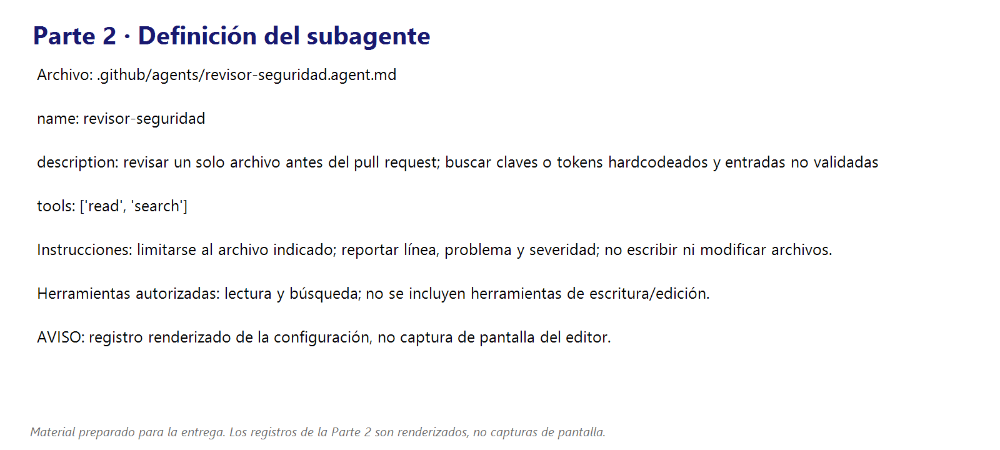
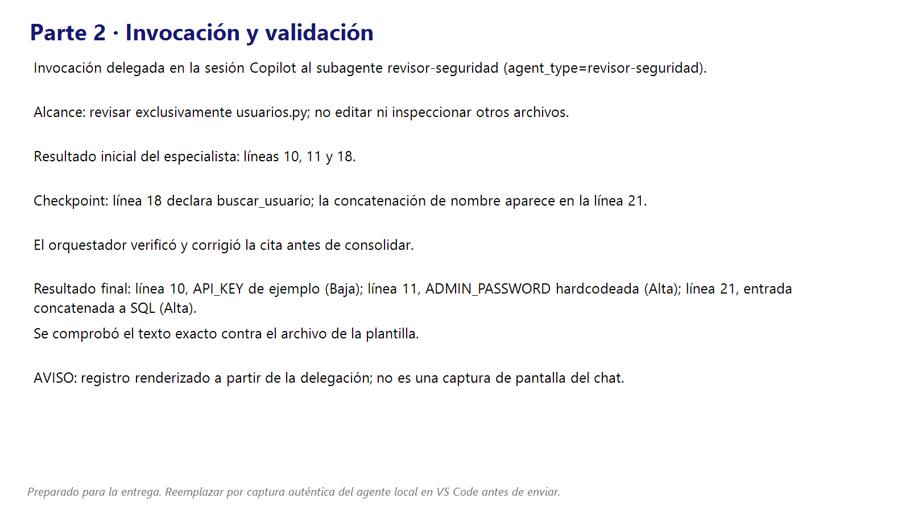
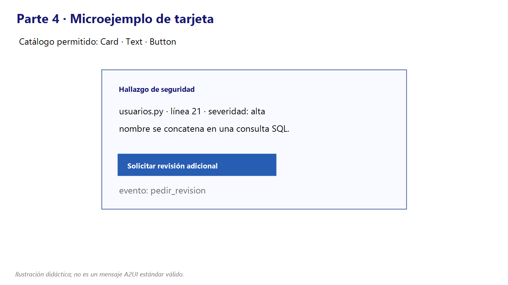

# Respuestas y evidencia

## Parte 2 — Subagente local

- **Herramienta y versión:** VS Code 1.144.1 con el harness Copilot SDK de esta sesión. El entorno no expone la versión del SDK/extensión. No están instalados Claude Code, Codex ni Gemini CLI; no afirmo una versión que no pude verificar.
- **Archivo de configuración:** `.github/agents/revisor-seguridad.agent.md`, Markdown con frontmatter para agentes personalizados de Copilot. Permite buscar y leer; no incluye herramientas de escritura/edición. La disponibilidad del archivo no implica que la extensión ya lo haya registrado: puede requerir reiniciar o recargar los agentes en VS Code.
- **Invocación efectuada:** esta sesión delegó al subagente `revisor-seguridad` con `agent_type=revisor-seguridad` en el harness de Copilot. La llamada fue real; no fue el agente principal fingiendo ser el especialista. No se usó Claude Code, Codex ni Gemini CLI.
- **Solicitud usada:** “Revisa exclusivamente `usuarios.py`; busca secretos hardcodeados y entradas sin validar/sanitizar; informa línea, problema y severidad; no edites ni revises otros archivos.”
- **Límites de escritura:** el agente delegado recibió una tarea de lectura y búsqueda; la definición local solo enumera herramientas de búsqueda/lectura. Esto limita las herramientas expuestas, pero no sustituye la verificación del estado de Git. `usuarios.py` se copió sin cambios desde la plantilla porque faltaba en este directorio. Antes de entregar, verifica `git diff -- usuarios.py` y no incluyas ese archivo en los cambios del PR de tu repositorio creado desde la plantilla.

El subagente inicialmente citó la concatenación de `nombre` como línea 18. En el checkpoint, el orquestador comprobó que la línea 18 declara `buscar_usuario` y que la concatenación está en la línea 21. Se corrigió la referencia antes de consolidar; este es un ejemplo de cómo detectar y corregir una salida parcialmente errónea.

Resultado consolidado después de verificar las líneas:

| Línea | Problema | Severidad |
|---:|---|---|
| 10 | `API_KEY` está escrita directamente; el comentario de la plantilla la identifica como falsa/de ejemplo, no como credencial real. | Baja |
| 11 | `ADMIN_PASSWORD` contiene una contraseña literal utilizada en la comprobación de administrador. | Alta |
| 21 | `nombre` se concatena en la consulta SQL sin validación/sanitización ni parámetros; permite inyección SQL. | Alta |

Se contrastaron las líneas con el archivo de la plantilla. No se reportó la
inserción de `crear_usuario` como inyección SQL porque usa parámetros `?`;
la ausencia de validación de dominio para edad/correo puede ser una mejora,
pero no se reportó como hallazgo confirmado de esta revisión acotada. Los
valores de ejemplo no deben confundirse con credenciales reales.

### Consolidación del orquestador

| Tipo | Referencia | Resultado | Estado |
|---|---|---|---|
| Seguridad | Línea 10 | Clave de ejemplo hardcodeada; la plantilla la marca como falsa | Revisado |
| Seguridad | Línea 11 | Contraseña literal usada en la comprobación de administrador | Revisado |
| Seguridad | Línea 21 | Entrada `nombre` concatenada directamente en SQL | Revisado |
| Prueba propuesta | `buscar_usuario` | Comillas/caracteres SQL se tratan como datos y no alteran la consulta | Propuesta; no ejecutada |
| Prueba propuesta | `crear_usuario` | Edad negativa y correo mal formado se rechazan | Propuesta; no ejecutada |
| Prueba propuesta | `calcular_descuento` | Límites 0/100 y porcentajes fuera de rango se manejan según política | Propuesta; no ejecutada |

### Nota conceptual

La delegación ejecutada fue un subagente local del harness de Copilot de esta
sesión: el orquestador del harness pasó una tarea a otro agente y recibió su
resultado. No implementa A2A: no hubo Agent Card, descubrimiento de un agente
remoto ni comunicación mediante un protocolo de red A2A. MCP tampoco equivale
a A2A; MCP proporciona herramientas/recursos al agente.





## A2UI

**Salida convencional**

| Archivo | Línea | Severidad | Hallazgo |
|---|---:|---|---|
| `usuarios.py` | 21 | Alta | `nombre` se concatena en una consulta SQL sin validación/sanitización ni parámetros. |

**Catálogo permitido para este ejemplo:** `Card`, `Text` y `Button`. El cliente
rechaza cualquier componente fuera de esta lista.

*Ilustración didáctica; no es un mensaje A2UI estándar válido.*

```json
{
  "component": "Card",
  "children": [
    {
      "component": "Text",
      "text": "usuarios.py · línea 21 · severidad: alta"
    },
    {
      "component": "Text",
      "text": "La entrada nombre se concatena en una consulta SQL."
    },
    {
      "component": "Button",
      "label": "Solicitar revisión adicional",
      "event": "pedir_revision"
    }
  ]
}
```

Un agente o una plantilla produce la descripción estructurada; A2UI es el
formato/protocolo para describir la interfaz, no un LLM. El LLM puede generar
esa descripción o una herramienta puede devolver una plantilla predefinida.
El flujo es: descripción → cliente valida esquema, catálogo, datos y acciones
→ renderer dibuja componentes ya implementados → persona actúa → evento de
retorno. MCP no es un paso obligatorio del renderizado. Generative UI es el
enfoque general de generar interfaces; una tabla Markdown o un artefacto
interactivo cualquiera no demuestra que use el formato declarativo A2UI.

El cliente rechaza JSON inválido y componentes no permitidos, bloquea acciones
sin autorización y no sigue URLs que no estén en una lista/origen autorizado.
También valida tamaños y tipos de datos; el catálogo es una barrera, no toda
la seguridad. El evento `pedir_revision` devuelve únicamente el identificador
del hallazgo y la referencia autorizada al archivo/línea, más el tipo de
acción. No incluye credenciales ni el contenido completo del archivo. El
botón no ejecuta por sí solo una operación sensible: el backend comprueba
sesión, autorización, alcance y política antes de atender el evento.



## Preguntas finales

1. **¿Por qué dos especialistas y no uno solo?** La separación permite revisar seguridad y cobertura de pruebas con instrucciones y criterios distintos, y correr ambas tareas en paralelo. Agrega coordinación, latencia y el riesgo de resultados inconsistentes; el orquestador debe validar y consolidar.
2. **¿Cómo verificaste la ejecución y los hallazgos? ¿Qué harías si fallara?** La respuesta llegó de una invocación delegada al subagente `revisor-seguridad`; luego se contrastaron líneas y texto con la copia exacta de la plantilla. El agente citó primero la línea 18 para la concatenación, pero esta define la función y la operación está en la 21. Se corrigió al verificar el código. Si el error persistiera, avisaría a la persona sin presentar el resultado como verificado.
3. **¿Qué permisos mínimos le diste y qué no pudo garantizar la herramienta?** El subagente recibió solo lectura/búsqueda; la definición local no incluye escritura. La versión concreta de Claude/Codex/Gemini no está instalada aquí, así que no afirmo que un CLI de esos imponga aislamiento. La configuración de herramientas reduce capacidad, pero no reemplaza `git status`/`git diff`.
4. **¿Cuándo bastan subagentes locales y cuándo conviene A2A?** Los locales bastan cuando el trabajo ocurre en el mismo entorno y no hace falta interoperar con otro equipo. A2A compensa cuando un agente remoto independiente ofrece una skill compatible y existe un mecanismo aceptable de descubrimiento, autenticación y confianza.
5. **¿Cómo manejaría `input-required` o un fallo de Task?** En `input-required`, pediría el dato a la persona y solo reanudaría tras validarlo; en `failed`, conservaría el error, no inventaría un resultado y avisaría o reintentaría de forma acotada.
6. **¿Qué valida el cliente y qué verifica el backend?** El cliente valida JSON/esquema, componentes permitidos, datos, URL/origen y acción. El backend valida identidad, autorización, alcance y política antes de ejecutar el evento, y vuelve a comprobar que la referencia al hallazgo sea válida.
7. **¿Cuándo conviene una plantilla fija?** Cuando la interfaz es repetitiva o de riesgo elevado y se priorizan consistencia, previsibilidad y validación sencilla sobre flexibilidad visual.

## Estado de las evidencias

`parte1_flujo.png`, `parte3_a2a.png` y `parte4_interfaz.png` son diagramas
renderizados para esta entrega. `parte2_subagente.png` y
`parte2_llamada.png` son registros gráficos fieles a la configuración y al
resultado delegado, pero no capturas de pantalla de VS Code. El deber pide
capturas auténticas de la Parte 2; reemplázalas desde la herramienta que uses
antes de entregar. No subas registros que expongan rutas privadas ni datos
sensibles.
